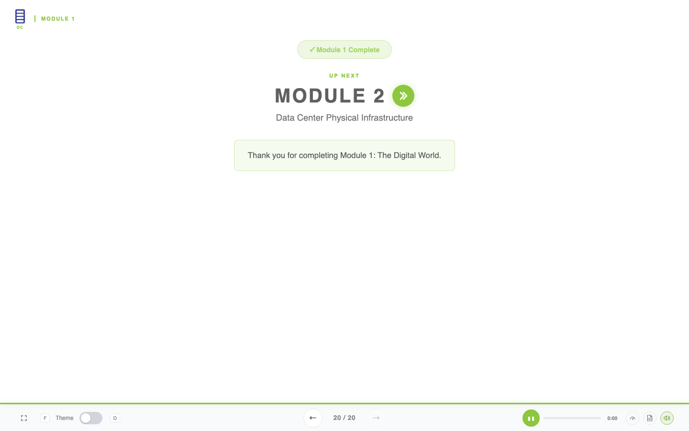
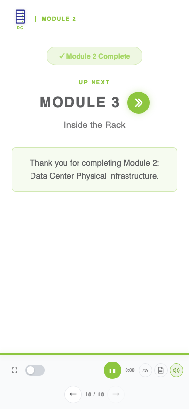

# Green next-module navigation refresh — 2026-10-27

The rebuilt Slides course keeps each authored green double-chevron next-module link visible and clickable in local, review and LMS API-present playback. The latest installed AcademyWizard learner template is merged into the course-pinned toolchain. Review links carry `review=1` and open the next module at slide 1. Course Home retains the maintained compatibility policy.

SCORM remains 1.2 with Course Home first and four teaching-module SCOs (five total). The manifest is byte-identical to the previous Home-first delivery. All 86 narration/video files, approved course content, assessment keys, catalog descriptions and slide markup outside scripts are unchanged. The ZIP changes only the four generated module pages. No TTS synthesis or video encoding was performed.

Validation passed:

- 48 navigation cases: three module endings, desktop/phone, light/dark, local/review/LMS/LMS-review. Every button has matching green appearance and target; every real click opens the next module at slide 1. Review stays isolated from LMS writes.
- 15 tracking/API checks covering independent module launches, completion, saved answers, matching encoding, retry clearing, bookmarks, review isolation, Home lifecycle and visible save failures. Largest saved state: 427 characters of 4096.
- 252 media layout states with no flags or JavaScript errors, plus 21 synchronized-video and 720 playback-policy assertions.
- Package/schema validation and strict 158-file ZIP audit. A fresh editable-source build using existing audio reproduces every runtime byte.

The navigation fixture uses a persistent parent SCORM 1.2 API in an isolated browser and proves UI/destination parity. Actual Docebo target-SCO tracking is a separate deployment check; no live upload or tracking reset was performed. Browser playback was muted. The existing imported cooling recording remains the only package-size notice.

Run `node authoring/qa/green-navigation-refresh/navigation_parity.mjs /absolute/path/to/built-course` with Playwright available. Detailed results are in `navigation-parity-results.json`, `media-layout/media-layout-results.json`, and `package-audit.json`.

User acceptance: on 2026-10-27, the user confirmed the rebuilt course was working and requested publication of this PR update. Automated test evidence remains scoped to the isolated browser/API fixtures described above.
