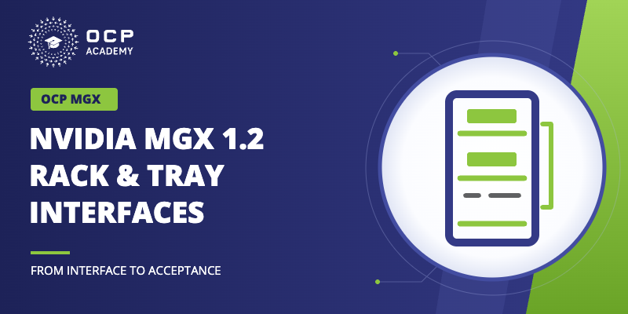

# NVIDIA MGX 1.2 Rack and Tray Interfaces

## Short description

Review MGX 1.2 rack, tray, power, and cooling interfaces with CAD motion and 2026 Summit reference-design examples.

## Long description

Mechanical, electrical, liquid, and module interfaces for deep technical integration reviews, with selected 2026 OCP Global Summit power-reference examples.

Total narrated runtime: 68.2 minutes. Planned learner time: about 95 minutes, including knowledge checks, drawing review, and the acceptance exercise. The full Summit recording is optional and excluded from this duration.

Module 1: Rack geometry, datums, and alignment (11 min narrated)
Trace the mechanical reference chain, datums, tolerances, and interface alignment; distinguish the specification boundary from surrounding power-system context.

Module 2: Tray architecture, board envelopes, and DC-SCM (11 min narrated)
Interpret hybrid and fanless tray examples, board mounting and keepout rules, and the management-module interface.

Module 3: Modular I/O bay dimensions and retention (11 min narrated)
Decode bay locations and depth variants, and verify mounting, retention, and fanless interface dimensions.

Module 4: Busbar electrical design and grounding (12 min narrated)
Locate the 800 VDC-to-low-voltage conversion in the Summit reference design, then apply MGX busbar ratings, grounding variants, insulation, and electrical acceptance conditions.

Module 5: Liquid cooling and blind-mate mechanics (12 min narrated)
Trace the liquid interfaces and blind-mate mechanics, and use the Summit power-supply/clip example to distinguish component cooling from rack and tray requirements.

Module 6: Load cases, qualification, and integration review (12 min narrated)
Interpret load cases and qualification evidence, distinguish transient power smoothing from steady-state tests, and assemble a source-linked integration review.

## Poster

Standalone course. Durations are rounded individually; total measured narration is 68.18 minutes.
