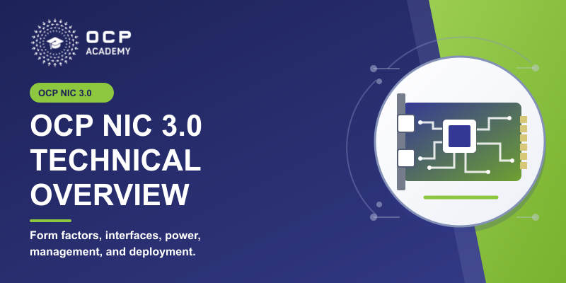

# OCP NIC 3.0 Technical Overview



A six-module OCP Academy course on the released OCP NIC 3.0 Design
Specification, version 1.6.0. It covers form factors, electrical interfaces,
power sequencing, management, cooling, and implementation requirements.
This is one standalone course with six modules, not a new multi-course series.

The editable source includes `course.json`, 61 narration scripts, figures,
six silent teaching videos, measured animation timelines, and the 800 x 400
LMS poster. Generated WAVs, rendered HTML, alignment sidecars, and SCORM ZIPs
are intentionally excluded from source control.

## Modules

Approximate narrated durations below total 44 minutes. Allow about 50 minutes
with knowledge checks and review.

- **Module 1: Introduction to OCP NIC 3.0 (8 minutes).** Purpose, tenets, form
  factors, non-NIC scope, and ecosystem. Motion compares single-host 1 x16,
  single-host 2 x8, and multi-host 4 x4 as alternative supported configurations.
- **Module 2: Form Factors & Mechanical Design (7 minutes).** Dimensions,
  connectors, faceplates, and retention. Motion illustrates a designed
  convertible bay, middle-guide-rail removal, and DSFF connector alignment.
- **Module 3: Electrical Interface (9 minutes).** Signal ownership, discovery,
  bifurcation, and power. The rebuilt sequence distinguishes edge rails,
  enables, readiness, and reset; optional Programming Mode is a separate ID
  branch, not a fifth normal power-up step.
- **Module 4: Management & Firmware (6 minutes).** NC-SI, FRU identity,
  telemetry, and firmware. Motion distinguishes control and pass-through,
  arbitration, inactive-slot bypass, and separate data isolation.
- **Module 5: Signal Integrity, Thermal & Environmental (7 minutes).** PCIe
  fixtures, airflow, cooling tiers, and environmental tests. Motion compares
  opposite airflow directions with fixed card orientation and top-side cooling.
- **Module 6: Compliance, Ecosystem & Future (7 minutes).** Required versus
  recommended compliance, released v1.6.0 changes, and resources. Motion
  distinguishes DSFF presence from FRU-declared capability and configuration.

Every module retains its narrated, two-question knowledge check. Seven approved
recordings were replaced with Leo (`bbGtsRRKUfYO634UxSjz`), Multilingual v2,
speed 1.18, stability 0.55, and similarity 0.75. The other 54 recordings are
unchanged in the reviewed local package. RoHS uses `Rose` in the spoken script.

## Build the Reviewed Package

SCORM 1.2 and seven separate syllabus entries (Course Home plus six modules)
are preserved. Do not migrate the version or tracking structure during a rebuild.

From the repository root, reuse the complete, reviewed audio folder:

```bash
EXISTING_AUDIO_DIR=/path/to/reviewed-course/audio \
  ./scripts/build-course.sh ocp-nic-3-0-technical-overview
```

The finished SCORM folder and LMS ZIP are created under `build/`. The course-local
build hook checks all six synchronized narration hashes and durations against
the measured timelines. It deliberately rejects fresh audio that no longer
matches the videos. A new recording must be aligned and its video re-rendered
and reviewed; simply regenerating every WAV through the generic build command
is not a valid synchronized-media rebuild.

## Animation Sources

`animations/scenes.mjs` defines measured text layouts and arrow geometry.
`animations/plan.json` records explicit script/playback approval, source pages,
and scene anchors. Each animation folder contains its final `master.json`.
The legacy Swift power-state source and MP4 are retained for history only;
the course no longer references that loop.

Install the course-local Node dependencies once:

```bash
npm install --prefix courses/ocp-nic-3-0-technical-overview/animations
```

For a working course folder containing the scripts, figures, WAVs, and seven
matching `.alignment.json` sidecars, generate finite 1080p, 30 fps silent H.264
videos with a full ffmpeg build:

```bash
export ACADEMY_ANIMATION_COURSE_DIR=/path/to/working-course
export FFMPEG_BIN=/path/to/ffmpeg
python3 courses/ocp-nic-3-0-technical-overview/animations/synthesize_animation_narration.py
node courses/ocp-nic-3-0-technical-overview/animations/render_course_animations.mjs --final --encode
node courses/ocp-nic-3-0-technical-overview/animations/test_course_animations.mjs
```

The narration helper defaults to a no-network check. Add `--generate` only for
approved new recordings; it reads `ELEVENLABS_API_KEY` or a hidden prompt, uses
the approved voice/settings, and retains provider character alignment. It
refuses changed scripts after approval and stale recordings without `--force`.
Generate these seven timestamped clips before using maintained `gen_audio.py`
for the remaining clips, so they are not synthesized twice.

After a media revision, inspect the final encoded frames at native resolution,
every transition, and 200% detail; review the full sequence. Then update each
hash-bound `figure.text_inventory` from the actual visible text. Only after
that review should source QA, audio QA, rendering, package validation, and the
strict zipper run. The renderer never silently refreshes review hashes.

Regenerate the exact-logo poster with:

```bash
node courses/ocp-nic-3-0-technical-overview/animations/render_course_poster.mjs
```

`ACADEMY_WIZARD_SKILL_DIR` optionally selects another maintained skill copy;
the repository skill is used by default. QA frames and drafts are ignored.

## Validation and Limits

The reviewed local package passes all 61 audio signal checks, every-frame text
containment (13,643 frames), arrow geometry, full video decoding, one-frame
duration tolerance, and encoding quality (30 samples above SSIM 0.995 and
PSNR 45 dB). Source QA verifies 34 glossary placements and 32 PDF references.
All seven pages and the strict 96-file SCORM archive validate.

Human listening, interactive browser playback, and target-LMS acceptance were
not verified in the production session. Signal checks are not pronunciation
approval. Test pause/seek/replay, zoom, quiz/resume, separate SCO completion,
and syllabus navigation in the actual target LMS before production replacement.
The direct first-module home action cannot itself switch SCORM 1.2 tracking
context; the LMS syllabus remains the module-launch mechanism.

## Public References

- [OCP NIC 3.0 Design Specification, released v1.6.0](https://www.opencompute.org/documents/ocp-nic-3-0-r1v60-20250410a-tn-no-cb-pdf)
- [OCP NIC Subproject](https://www.opencompute.org/community/mezz-nic)
