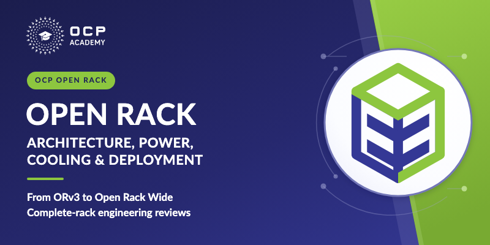

# Open Rack: Architecture, Power, Cooling and Deployment

[OCP Academy course 95](https://academy.opencompute.org/learn/courses/95/) · [English narration and knowledge checks](content/Narration-and-questions.md) · [LMS descriptions](lms-catalog.md)

The November 19 English edition follows a compute tray through Open Rack v3 and Open Rack Wide. It uses contributed frames and real systems to distinguish a shared rack interface from a manufacturer's design choice. The course is one SCORM 1.2 package: Course Home plus four separately tracked modules, 64 narrated slides, ten synchronized teaching animations and eight knowledge-check questions. Estimated learner time is **63 minutes**, including one minute for Course Home. Optional references and Summit recordings are extra.



| Module | What learners explore | Slides | Minutes |
|---|---|---:|---:|
| Inside Open Rack | Frame, tray supports, latch and busbar; ORv3 and ORW | 10 | 16 |
| How servers and switches fit into the rack | Mounting kits, equipment width and depth, OpenU and RU, cable service space | 17 | 15 |
| What changes as racks carry more power and heat? | Power shelves, high-power racks, Mt. Diablo, and the two cooling loops | 21 | 17 |
| Open Rack in practice | Meta and Google frames, HPE’s implementation of AMD Helios, Supermicro’s wide chassis, and a loaded rack’s turning path | 16 | 14 |

## Languages and earlier editions

The seven published [translations](locales/) still teach the **seven-module, 145-minute** Slides edition. This English update does not replace those materials. Each locale has its own scripts, figures, recordings and LMS description; use its own course file when building. For translation alignment, dubbing or historical English sources, use [the matching seven-module English revision](https://github.com/opencomputeproject/ocp-academy-courses/tree/9802bb10c8178a12a90a9b2c5526c20e9ff0a515/courses/open-rack-architecture-power-cooling-deployment), not the four-module English manuscript. The previously published [localization validation](provenance/localization-validation-2026-11-10.json) describes that edition. The older scrolling series is a separate [historical replacement](provenance/replacement.json).

## Rebuild the English course

The source of record is [course.json](course.json). It specifies module order, transcripts, quiz choices and feedback, glossary, references and media. The matching text files under `audio/` contain pronunciation-aware scripts. Editable SVGs, retained figure artwork, one-pass videos and posters are in `figures/`. The repo builds the two specialized interactions in Module 1 with [the course renderer](render_open_rack.py); the remaining slides use the standard Academy player.

From the repository root, with Python, rsync and ffmpeg available:

```sh
EXISTING_AUDIO_DIR=/path/to/approved/english/audio \
  ./scripts/build-course.sh open-rack-architecture-power-cooling-deployment
```

Supply the paced WAV masters at their paths relative to `audio/`, or omit `EXISTING_AUDIO_DIR` and set `ELEVENLABS_API_KEY` for fresh paid narration. The voice is Leo (full Eleven v4) at pitch-preserving 1.18× authoring pace. Delivery is 96 kbps mono MP3; the learner's speed control starts at 1×. Regenerated speech can move word cues: retime affected animations before publishing. Course Home and module pages open from disk. The LMS ZIP and metadata sidecars go under `build/`; generated HTML, WAVs, narration MP3s, ZIPs and credentials are not source files.

The [animation scene library](animations/render.py), [narration-timed sequences](fresh/motion.py), approved word timings and [source plates](animations/source-plates/) are editable. The mounting-kit crops use Google's ORv3 frame specification (PDF pp. 9 and 16) and the ORv3 IT Gear Design Guide (PDF p. 5); the source URLs and learner references are in the course file. For media edits, install Pillow and imageio-ffmpeg, place the paced WAV beside its script, and run the following **from this course folder** for the affected slide:

```sh
python3 align-motion.py --fresh m4s9    # ElevenLabs forced alignment if the script/audio changed
python3 fresh/motion.py m4s9            # 1080p animation, poster and updated inventory
```

For M1S3, omit `--fresh` during alignment and use `python3 animations/render.py m1s3`. After editing media, update its duration and reviewed text inventory in `course.json`, review the final frame and narration together, and rerun source and package validation. The package always uses the checked-in media; an ordinary build does not re-encode videos.

The approved English [poster](poster.json) is shared by all editions. [Catalog JSON](lms-catalog.json) and [Markdown](lms-catalog.md) are stored separately from the learner package. The [November 19 release record](provenance/english-2026-11-19.md) identifies the validated English delivery. A change in SCO structure is not a tracking-preserving in-place update.
