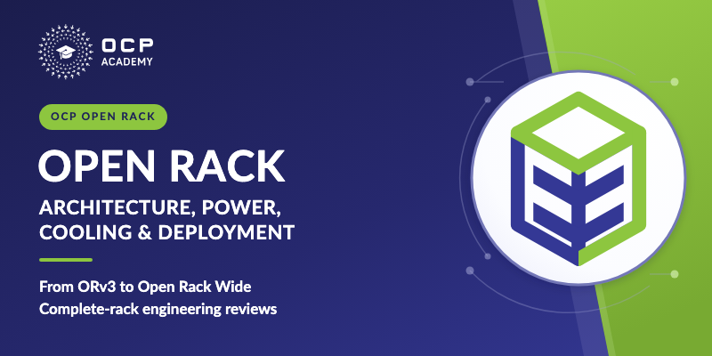

# Open Rack: Architecture, Power, Cooling and Deployment

One narrated, seven-module **Slides** course for OCP Academy: 112 slides, 100 narration scripts, 16 narration-synchronized teaching videos, 20 static figures, 12 embedded expert recordings with English captions, and 35 glossary entries. Estimated learner time is **145 minutes**, including the embedded recordings and knowledge checks; linked external study is additional.



## Replacement of the scrolling series

This course replaces the seven independent Scrolling courses formerly under `courses/open-rack-v3/`. Those English course folders and their 49 translated editions are removed in this replacement, not retained as parallel active courses. The new source is English-only; the previous translations do not represent this revised curriculum. Earlier source remains recoverable from Git history. See [replacement provenance](provenance/replacement.json).

New editions in all seven previous languages are tracked in [translation issue #124](https://github.com/opencomputeproject/ocp-academy-courses/issues/124).

This consolidates seven separately uploaded courses into one SCORM 1.2 package with separately tracked content modules. Do not assume old bookmarks, attempts or completions transfer. Export needed LMS reports and test a separate upload before retiring prior LMS material. Repository replacement does not delete or modify live LMS content.

The approved LMS syllabus has **eight entries: Course Home first, then Modules 1–7**. Course Home completes on launch; content-module completion and quiz gates remain independent. This Home choice was explicitly confirmed on 2 November 2026.

## Course modules

| Module | Topic | Learner time |
|---:|---|---:|
| 1 | Open Rack Architecture and the Open Ecosystem | 18 min |
| 2 | ORv3: Mechanical, Power and Cooling Interfaces | 25 min |
| 3 | Selecting, Integrating and Validating an ORv3 Deployment | 17 min |
| 4 | High-Power Racks: Capacity, Resilience and Control | 24 min |
| 5 | Scaling Power: Sidecars, Higher Voltage and Workload Dynamics | 19 min |
| 6 | Open Rack Wide: Frame, Payload and Facility Integration | 20 min |
| 7 | Liquid Cooling, Serviceability and the Integrated Design Review | 22 min |

Formal LMS title, short description and long description are maintained separately in [lms-catalog.md](lms-catalog.md) and [lms-catalog.json](lms-catalog.json), generated from `course.json.lms_catalog`.

## Catalog poster

`thumbnail.png` is the 800×400 Academy catalog poster, matching the SST/AICC navy-and-green treatment and using the approved Open Structure mark. The editable source is [poster/poster.html](poster/poster.html); it reuses the repository's authoritative Academy logo and bundled Lato font rather than rasterized rack artwork.

With Playwright available, regenerate it from the repository root:

```bash
node courses/open-rack-architecture-power-cooling-deployment/poster/render.mjs
```

The renderer checks text bounds and local asset loading, writes the course thumbnail, and saves 400×200 and 240×120 inspection previews under the ignored `build/poster-qa/open-rack/` directory. The catalog poster is delivered separately from the SCORM runtime; replacing it does not change the existing ZIP.

## Editable source and rebuilding

`course.json` is authoritative. `content/` contains the manuscripts, and `audio/module*/` contains the pronunciation-aware scripts and editable narration VTTs. Scripts retain full Eleven v4 / Leo with pitch-preserving 1.18 pacing; the learner dial remains 1.0. The approved learner delivery is **96 kbps CBR mono MP3**. WAV masters, MP3 delivery files, runtime HTML and SCORM ZIPs are generated and are not committed.

From the repository root, use the normal build command with ElevenLabs access for fresh narration, or reuse approved final WAVs without making TTS requests:

```bash
FFMPEG_BIN=/path/to/ffmpeg EXISTING_AUDIO_DIR=/path/to/approved/audio ./scripts/build-course.sh open-rack-architecture-power-cooling-deployment
```

The build creates MP3 delivery copies, checks the lossless masters, renders the course and packages only manifest-listed runtime assets. `audio.wav_file` remains the master path; `audio.delivery_file` selects playback and packaging. Encode receipts are saved beside the build, not in its SCORM runtime. No API key is stored here.

Open generated `index.html` and `module1.html` through `module7.html` directly from disk for review; no server is needed. `?review=1` isolates editorial playback from saved progress. Original recordings use their own players, sound and caption overlays; slide narration is disabled on those slides. Do not run an additional slide narration track over an original recording.

## Media and source evidence

`figures/` contains editable SVG figures, the reviewed finite videos and their posters. `animations/` retains self-contained editable HTML timelines, cue maps and source plates. Videos follow the narration clock, play once and hold their completed picture in embedded and enlarged views. Regenerating narration can change semantic timing: review the cue maps, retime and re-encode affected videos with the maintained `record_css_animation.mjs`, then review geometry, legibility and final-frame hold before refreshing media inventories.

`resources/` retains the 12 original recordings, posters and editable captions. Their source hashes and prior repository revision are recorded in [original-recordings.json](provenance/original-recordings.json). Four supplied VTTs are byte-preserved; eight missing tracks were locally transcribed and reviewed. Recorded earlier implementations and roadmaps are distinguished from current specification requirements in slide context.

PDF source evidence remains in `source_refs`. All opencompute.org page-specific links are preserved. Learner-facing Summit references use official OCP YouTube recordings rather than Dropbox page downloads; full recordings are used when concept timestamps cannot be verified. See [the recording mapping](provenance/summit-video-references.json). The source includes related Academy courses, including Open Data Center for AI and Grid Disturbance Performance, at the relevant teaching points.

## Validation and LMS testing

Source QA covers glossary first use, media inventories, references and arrow geometry. All 100 MP3s fully decode; all WAV master hashes remain unchanged, with at most about 1 ms decoded-duration difference. Local checks cover synchronized video playback, seeking, speed, enlargement, final hold and replay at desktop and phone sizes, original-video captions, quiz persistence and bookmarks. The approved Open Structure mark is `open-rack-mark.svg`.

Local checks do not establish target-LMS tracking. Verify syllabus launches, bookmarks, quiz attempts, module completion and direct Start/Next handoffs in the LMS. SCORM version or tracking changes require a separate migration decision; do not delete old LMS material as part of a repository build.

The 2 November 2026 delivery passed package validation and strict ZIP integrity checks: 200 runtime files, 100 MP3 clips, and the eight ordered syllabus entries. Release-page checks include all 12 recordings and 92 visible-caption checks at desktop/phone sizes, Home/resume behavior, and representative synchronized-video checks. See [the validation receipt and delivery checksum](provenance/validation.json). The generated ZIP and LMS HTML delivery copy remain outside Git.
